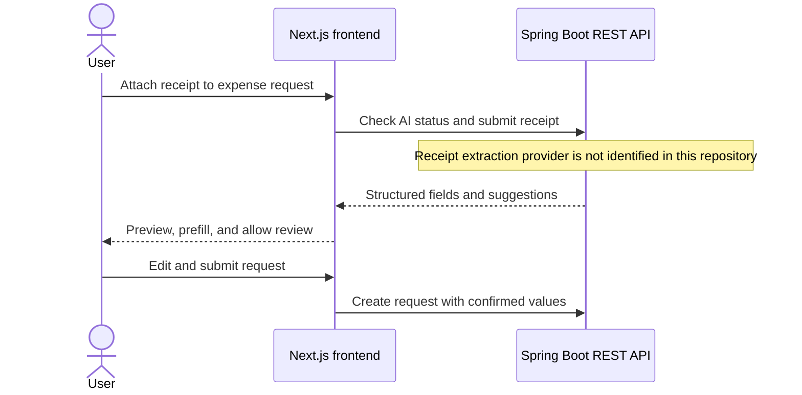
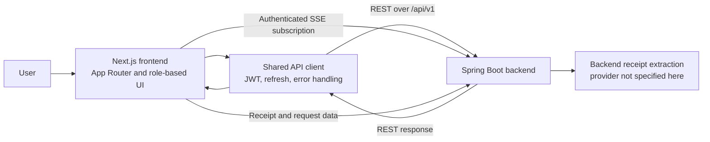

<div align="center">

# IFMS

### Internal Financial Management System

A role-based financial management platform for company wallets, project budgets, expense workflows, and financial oversight.

[](https://nextjs.org/)
[](https://react.dev/)
[](https://www.typescriptlang.org/)
[](https://tailwindcss.com/)
[](https://recharts.org/)
[](https://zod.dev/)

## [VIEW LIVE APPLICATION →](https://internal-financial-cashflow-managem.vercel.app/)

[Portfolio](https://quoc-portfolio-roan.vercel.app/) · [GitHub profile](https://github.com/Quoosc) · [Contact](mailto:phamquoc896@gmail.com)

</div>

---

## Contents

- [Project overview](#project-overview)
- [Project preview](#project-preview)
- [Features](#features)
- [AI-assisted receipt processing](#ai-assisted-receipt-processing)
- [Engineering highlights](#engineering-highlights)
- [Architecture](#architecture)
- [Technology stack](#technology-stack)
- [My contributions](#my-contributions)
- [Run locally](#run-locally)
- [Links](#links)

## Project overview

IFMS (Internal Financial Management System) brings day-to-day company finance workflows into one role-based application. Employees can manage wallet activity and submit advance or expense requests; team leaders, managers, accountants, CFOs, and administrators work with the approval, project funding, disbursement, payroll, and oversight flows assigned to their roles.

This repository contains the **Next.js frontend**. It presents role-specific dashboards and workflows, validates user input, and connects to a separate Spring Boot REST API. Business rules, authorization enforcement, financial transactions, persistent data, and receipt extraction depend on backend services; the frontend does not implement those services or train an AI model.

## Project preview

The repository currently has no product screenshots in `public/`. The gallery is omitted until real application screenshots are available.

## Features

### Financial overview and dashboards

Six dashboards present role-relevant wallet, request, budget, payroll, or administrative information. Recharts visualizations include cash-flow and spending summaries where the dashboard API provides the data.

### Wallets and transactions

Users can view wallet balances and transaction history, and access deposit and withdrawal workflows. Transaction execution and balance changes are handled by the backend APIs.

### Projects and budgets

Project pages expose project, phase, member, and budget information. Team leaders and managers have dedicated project views and funding workflows.

### Requests and approvals

The interface supports advance, expense, and reimbursement requests, attachments, request details, and role-specific approval queues. The application also includes finance and department funding approval screens.

### Accounting and administration

Accountant workflows cover disbursements, payroll, withdrawals, and the ledger. CFO and administrator screens provide company-fund, configuration, user, department, role, and audit-log views.

### Role-aware navigation

Dashboard dispatch and sidebar navigation are tailored to six roles: Employee, Team Leader, Manager, Accountant, CFO, and Admin. The backend remains responsible for enforcing authorization on protected operations.

### Real-time updates

An authenticated Server-Sent Events (SSE) subscription handles wallet updates, new transactions, and notifications. The client reconnects when the stream closes and refreshes wallet and unread-notification data when a connection opens.

## AI-assisted receipt processing

For expense and reimbursement requests, the frontend checks the AI feature status and sends eligible receipt files to the backend receipt-extraction API. Users can preview image or PDF attachments alongside extracted fields, including the total, date, vendor, invoice identifiers, tax, and line items when returned by the API.

Returned values can prefill empty form fields, and the API can suggest an expense category for a selected project phase. Users can inspect, ignore, retry, and edit the results before submitting the request. If the AI feature is unavailable, manual entry remains available. The frontend integrates the API; the extraction provider and model are not identified in this repository.



## Engineering highlights

| Area | Implementation | Practical effect |
| --- | --- | --- |
| API integration | Shared typed client, REST calls, response handling, and centralized API errors | Keeps request behavior consistent across feature areas and surfaces actionable errors. |
| Authentication | JWT bearer tokens, refresh-token retry on `401`, and middleware redirects for protected navigation | Maintains the frontend session flow; backend authorization still governs access to data and operations. |
| Real-time data | Authenticated SSE stream with reconnection, event dispatch, and wallet/notification resynchronization | Reflects server-side wallet and notification changes without requiring a full page reload. |
| Data visualization | Recharts components across role-specific dashboards | Turns API-provided financial summaries into charts and dashboard views. |
| Form validation | Shared Zod schemas and inline validation/error states | Catches invalid request, wallet, password, and PIN input before submission. |
| Receipt review | Attachment preview, scan states, warnings, retry and ignore controls, and editable prefilled fields | Keeps extracted receipt values reviewable before a financial request is sent. |

## Architecture



The frontend uses a Next.js rewrite to forward `/api/*` requests to the configured backend base URL. The REST API and SSE connection are backend-dependent; financial rules, persistence, and receipt extraction are outside this frontend repository.

## Technology stack

| Category | Technology | Purpose |
| --- | --- | --- |
| Frontend framework | Next.js 16.1.6, React 19.2.3 | App Router pages, layouts, and interactive interfaces |
| Language | TypeScript 5 | Typed application code and API data models |
| Styling | Tailwind CSS 4 | Responsive interface styling |
| Charts | Recharts 3.8.1 | Dashboard data visualization |
| Validation | Zod 4.3.6 | Client-side form validation |
| Realtime client | `@microsoft/fetch-event-source` 2.0.1 | Authenticated SSE subscriptions and reconnect behavior |
| Backend API | Java 21, Spring Boot 3.4.x | Separate REST and SSE services consumed by the frontend |

Frontend versions are taken from `package.json`. Backend technologies are identified in the backend project documentation and are not dependencies of this frontend package.

## My contributions

**Role: Frontend Developer**

- Built role-specific dashboards, navigation, and finance workflows with Next.js, React, and TypeScript.
- Integrated the frontend with Spring Boot REST endpoints through a shared API client, including JWT session refresh and consistent error handling.
- Implemented SSE event handling for wallet activity and notifications, with reconnect and data resynchronization behavior.
- Added Zod-based validation and dashboard visualizations for financial summaries.
- Integrated the backend receipt-scanning flow into expense forms, including upload, preview, editable field suggestions, and user review.

Backend business logic, data storage, financial authorization, and the AI extraction service are maintained by the backend system.

## Run locally

### Requirements

- Node.js and npm
- A running IFMS Spring Boot API for authenticated and data-backed workflows

### Setup

```bash
npm install
```

Set one backend URL in `.env.local` if the API is not running at the default `http://localhost:8080`:

```env
NEXT_PUBLIC_API_URL=http://localhost:8080
```

`NEXT_PUBLIC_API_BASE_URL` is also accepted as a fallback. Do not put credentials or private secrets in `NEXT_PUBLIC_*` variables. Then start the frontend:

```bash
npm run dev
```

Open [http://localhost:3000](http://localhost:3000). Protected workflows require an authorized account and a reachable backend; no demo credentials are published here.

## Links

- **Live demo:** [internal-financial-cashflow-managem.vercel.app](https://internal-financial-cashflow-managem.vercel.app/)
- **Source code:** [Quoosc / Internal Financial Management System](https://github.com/Quoosc/Internal_Financial_Management_System)
- **Portfolio:** [quoc-portfolio-roan.vercel.app](https://quoc-portfolio-roan.vercel.app/)
- **GitHub:** [github.com/Quoosc](https://github.com/Quoosc)
- **Email:** [phamquoc896@gmail.com](mailto:phamquoc896@gmail.com)
