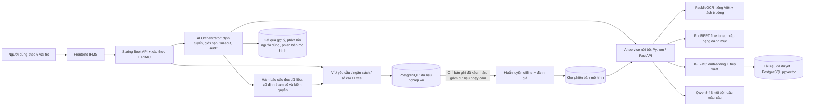

# Kiến trúc tích hợp AI nội bộ cho IFMS — đề xuất để thẩm định

> **Trạng thái:** tài liệu thiết kế, **chưa triển khai** các thành phần AI nội bộ bên dưới.  
> **Mục đích:** thống nhất phạm vi và cách đánh giá trước khi sửa code; dùng để báo cáo hướng phát triển đồ án 2.  
> **Phạm vi thay thế:** thay các **lệnh gọi nhà cung cấp AI bên ngoài** bằng xử lý tại máy chủ IFMS. REST API giữa frontend và backend, API nghiệp vụ, phân quyền, quy trình duyệt, ví và sổ cái **vẫn cần tồn tại**.

## Kết luận kiến trúc để nói với GVHD

**Tên phương án:** *Hybrid AI nội bộ cho IFMS: fine tuning mô hình phân loại danh mục + RAG hỏi đáp tài liệu + truy vấn nghiệp vụ có kiểm soát + OCR chứng từ chạy nội bộ.* Đây là **bốn kỹ thuật khác nhau** cùng phục vụ một hệ thống, không phải “dùng RAG để train mô hình”.

| Kỹ thuật chốt | Mô hình/công cụ dự kiến | Dùng chính xác vào việc gì? | Nhóm có train không? |
|---|---|---|---|
| **Fine tuning PhoBERT** | `vinai/phobert-base` + bộ phân loại cặp văn bản | Chấm mức phù hợp giữa mô tả khoản chi và **từng danh mục được phép**; gợi ý ở form yêu cầu và từng dòng Excel | **Có**: nhóm tạo dữ liệu gắn nhãn, huấn luyện thêm và đánh giá |
| **RAG nội bộ** | `BAAI/bge-m3` tạo vector → `pgvector` trong PostgreSQL → `Qwen3-4B-Instruct-2507` chạy nội bộ | Tìm đúng đoạn quy trình/tài liệu IFMS trước khi trả lời câu hỏi; câu trả lời có link nguồn | **Không**: dùng mô hình có sẵn để truy xuất và diễn đạt |
| **Hỏi đáp số liệu bằng công cụ** | Qwen nhận diện ý định → các hàm báo cáo Spring Boot có kiểm quyền | Trả lời về tạm ứng, ngân sách, giải ngân, giao dịch ví, sổ cái; số tiền lấy từ backend | **Không**: AI không tự tính tiền hoặc sinh SQL |
| **OCR nội bộ** | PaddleOCR cấu hình tiếng Việt + bộ tách trường/kiểm tra của IFMS | Đọc ảnh/PDF chứng từ để điền gợi ý và đối chiếu | **Không ở giai đoạn đầu**: dùng OCR có sẵn, đo chất lượng riêng |

**Một câu trình bày:** “Nhóm sẽ **fine tune PhoBERT** trên các khoản chi đã được xác nhận để gợi ý danh mục; dùng **RAG với embedding BGE-M3, pgvector và mô hình ngôn ngữ Qwen chạy nội bộ** để hỏi đáp quy trình có nguồn; câu hỏi số liệu được chuyển tới **hàm báo cáo Spring Boot có phân quyền**; chứng từ được đọc bằng **PaddleOCR nội bộ**. RAG không phải training, phần training của nhóm là fine tuning PhoBERT.”

Đây là **stack mục tiêu để kiểm chứng**, không phải tuyên bố các mô hình đã chạy trong IFMS. Việc đưa Qwen và BGE-M3 vào máy chủ thật phụ thuộc thử tải phần cứng và chất lượng tiếng Việt; nếu không đạt, câu hỏi số liệu vẫn trả bằng mẫu câu từ backend, còn câu hỏi tài liệu chỉ hiện các đoạn nguồn tìm được. Không được thay bằng `mock` rồi báo cáo là AI đã chạy nội bộ.

## 1. Điểm xuất phát của hệ thống

IFMS hiện có luồng hỗ trợ đọc chứng từ và gợi ý danh mục chi khi nhân viên tạo yêu cầu. Backend chọn `gemini` hoặc `mock` qua `app.ai.provider`; kết quả trích xuất được lưu ở `document_extractions`, liên kết với yêu cầu và tệp đính kèm. Có hạn mức lượt gọi, thời hạn cache và các cảnh báo đối chiếu. Đây **chưa phải** mô hình do nhóm tự huấn luyện. Chế độ `mock` chỉ dành cho phát triển/demo, không phải AI nội bộ.

Các màn hình Excel, sổ cái kế toán, giao dịch ví, ngân sách, tạm ứng và bảng lương đã có API nghiệp vụ riêng. Chúng là **nguồn dữ liệu được phép đọc** cho tính năng AI phù hợp; không phải dữ liệu để chatbot tự tính lại hoặc tự ghi sổ.

| Năng lực | Hiện tại đã có | Trạng thái trong kiến trúc đề xuất |
|---|---|---|
| Đọc ảnh/PDF chứng từ | Có, qua Gemini hoặc mock | Chuyển sang OCR/trích xuất chạy nội bộ, sau khi đo độ chính xác |
| Gợi ý danh mục chi | Có, dựa trên kết quả đọc chứng từ | Thay bằng mô hình phân loại do nhóm huấn luyện |
| Đối chiếu số tiền/chứng từ | Có một số quy tắc backend | Giữ là kiểm tra nghiệp vụ xác định; bổ sung dấu vết xác nhận |
| Gợi ý khi nhập Excel | Chưa coi là mô hình đã huấn luyện | Dùng lại mô hình phân loại để đề xuất cho từng dòng khi xem trước |
| Hỏi đáp quy trình, số liệu tài chính | Định hướng trong tài liệu đồ án 2; không coi là đã có | Xây theo truy xuất tài liệu và hàm báo cáo có kiểm quyền |
| Dự báo dòng tiền bằng mô hình học máy | Chưa coi là đã có | Chỉ làm khi lịch sử thực tế đủ để kiểm chứng |

Tài liệu đồ án 2 trước đây có đề xuất F1 (chứng từ), F4 (hỏi đáp), F5 (dự báo) và mô tả nhà cung cấp AI bên ngoài. Tài liệu này **đề xuất kiến trúc triển khai nội bộ mới**; không tự động xác nhận F4/F5 đã được code.

## 2. Quyết định kiến trúc

Chọn **kiến trúc AI lai theo tác vụ, triển khai nội bộ**:

1. **Fine tuning PhoBERT** để học độ phù hợp giữa một khoản chi và một danh mục ứng viên. Đây là phần nhóm **tự huấn luyện và đánh giá**; TF–IDF là baseline để chứng minh fine tuning có cải thiện hay không.
2. **PaddleOCR nội bộ** cho chứng từ. Đây là mô hình đã có sẵn; không trình bày thành thành quả train của nhóm nếu chưa huấn luyện lại.
3. **Hỏi đáp hai đường:** câu hỏi quy trình dùng **RAG BGE-M3 + pgvector + Qwen nội bộ**; câu hỏi số liệu dùng **hàm truy vấn/báo cáo định sẵn** của Spring Boot rồi mới cho Qwen diễn đạt. Có đường trả lời xác định khi mô hình sinh không đạt chất lượng hoặc không đủ phần cứng.
4. **Quy tắc nghiệp vụ xác định** tiếp tục kiểm tra Excel, phép cộng tiền, quyền hạn, ngân sách, phê duyệt và ghi sổ. AI chỉ đề xuất/cảnh báo/diễn giải.

Không chọn một mô hình lớn để làm tất cả: bài toán phân loại, đọc ảnh, tra tài liệu và tính số liệu có đầu vào, phép đo và rủi ro khác nhau. **RAG không phải huấn luyện mô hình.** Fine tuning là mục tiêu nghiên cứu cụ thể; nếu số mẫu gắn nhãn không đủ hoặc kết quả kém hơn baseline, báo cáo trung thực và chưa dùng bản fine tune để gợi ý cho người dùng.

### Sơ đồ đích

`AI service` chỉ nằm trong mạng nội bộ giữa các container. Trình duyệt không gọi thẳng AI service hoặc cơ sở dữ liệu. Backend xác thực người dùng, lọc dữ liệu theo quyền và kiểm tra đầu ra trước khi trả về giao diện. Việc huấn luyện chạy **offline**, không xảy ra khi người dùng gửi yêu cầu.

## 3. Các tính năng AI và trải nghiệm người dùng

### A. Đọc và đối chiếu chứng từ

**Nơi dùng:** tạo/chỉnh yêu cầu, xem chi tiết yêu cầu, màn kế toán kiểm tra trước giải ngân hoặc quyết toán.

1. Nhân viên tải chứng từ. Backend lưu tệp và giao tác vụ trích xuất cho AI service nội bộ.
2. OCR trả về các trường có thể đọc được: nhà cung cấp, ngày, mã chứng từ, số tiền, thuế, mô tả; kèm vị trí/đoạn bằng chứng nếu công cụ hỗ trợ.
3. Backend kiểm tra định dạng, đối chiếu **bằng code** với số tiền nhân viên nhập, phát hiện chứng từ trùng theo quy tắc hiện có, rồi hiển thị cảnh báo.
4. Nhân viên/kế toán xem ảnh gốc, giá trị trích xuất và giá trị đã xác nhận. AI không tự sửa số tiền yêu cầu, không tự xác nhận chứng từ và không giải ngân.

**Điều kiện chuyển hoàn toàn khỏi Gemini:** OCR nội bộ đạt tiêu chí chất lượng đã chốt trên tập chứng từ thử độc lập. Nếu chưa đạt, người dùng nhập tay; tuyệt đối không biến kết quả OCR thành chứng từ hợp lệ chỉ vì có AI đọc được.

### B. Mô hình do nhóm huấn luyện: gợi ý danh mục chi

**Nơi dùng:** form tạo yêu cầu; màn xem trước dữ liệu Excel có mô tả khoản chi và danh mục phù hợp.

- **Vì sao không phân loại trực tiếp theo `categoryId`:** IFMS có danh mục mặc định và danh mục riêng theo dự án; Team Leader còn gán danh mục cho từng giai đoạn. Một danh mục mới không thể được mô hình phân loại theo ID cố định nhận biết nếu chưa train lại.
- **Bài toán fine tuning cụ thể:** đưa vào PhoBERT một **cặp văn bản**: `(mô tả khoản chi + nhà cung cấp + tóm tắt chứng từ, tên + mô tả danh mục)`. Mô hình học trả về điểm “phù hợp/không phù hợp”. Với một yêu cầu mới, backend lấy **chỉ các danh mục được phép ở giai đoạn đó**; AI chấm từng cặp rồi xếp hạng. Backend xác minh lại ID danh mục trước khi hiện gợi ý.
- **Cách tạo nhãn:** danh mục cuối cùng do người có thẩm quyền xác nhận tạo cặp dương; các danh mục khác cùng giai đoạn tạo cặp âm. Không lấy gợi ý chưa xác nhận làm đáp án. Loại bản ghi tranh chấp, trùng lặp và demo sinh hàng loạt chưa được gắn nhãn độc lập.
- **Pipeline train:** chuẩn hóa văn bản tiếng Việt → tách từ theo hướng dẫn của PhoBERT → chia tập train/validation/test theo yêu cầu hoặc theo thời gian → huấn luyện `AutoModelForSequenceClassification` với 2 nhãn → lưu model, tokenizer, bản đồ phiên bản và số đo. Dùng TF–IDF + mô hình tuyến tính trên cùng dữ liệu làm baseline.
- **Đầu ra:** tối đa vài danh mục hợp lệ, điểm xếp hạng và phiên bản mô hình; chỉ ghi “độ tin cậy” nếu điểm đã được hiệu chuẩn. Nếu không đủ chắc hoặc không có ứng viên phù hợp, trả “cần chọn thủ công”. Không dùng số tiền hoặc tên nhân viên làm lối tắt dự đoán nếu điều đó làm sai nghiệp vụ.

**Ví dụ:** dòng Excel “Thuê máy chủ kiểm thử ERP tháng 11” → gợi ý “Hạ tầng CNTT” trong danh mục của giai đoạn được chọn. Người nhập vẫn xem trước và xác nhận; Excel chưa được ghi vào nghiệp vụ chỉ vì AI đã gợi ý.

### C. Hỏi đáp AI về IFMS

Hỏi đáp phục vụ **tra cứu và giải thích**, không thay màn nghiệp vụ. Giao diện câu trả lời luôn cho biết phạm vi dữ liệu, thời gian tính và liên kết tới màn nguồn khi có.

| Loại câu hỏi | Ví dụ | Cách trả lời | Nơi nên đặt |
|---|---|---|---|
| Quy trình/hướng dẫn | “Tạm ứng khác hoàn chi thế nào?”, “Cần chứng từ gì để quyết toán?” | Tìm trong tài liệu nghiệp vụ **đã duyệt**, trả lời kèm tên mục và liên kết nguồn | Trợ giúp ở yêu cầu, tạm ứng, kế toán |
| Trạng thái của cá nhân | “Tôi còn khoản tạm ứng nào phải quyết toán?” | Backend lấy danh sách của **chính người hỏi**, trả số và đường dẫn; lớp AI chỉ diễn đạt | Mục tạm ứng của nhân viên |
| Kiểm tra yêu cầu | “Yêu cầu này thiếu gì trước khi kế toán xem xét?” | Hàm kiểm tra trạng thái, chứng từ và phê duyệt đã định nghĩa; dẫn tới chứng từ/yêu cầu | Chi tiết yêu cầu, chi tiết giải ngân |
| Sổ cái/giao dịch | “Khoản này đã ghi sổ và chuyển ví chưa?” | Hàm đọc liên kết yêu cầu → giao dịch ví → bút toán, phân biệt từng mốc; dẫn tới trang chi tiết | Trang sổ cái và chi tiết giao dịch của kế toán |
| Ngân sách | “Giai đoạn này còn bao nhiêu ngân sách khả dụng?” | Backend lấy báo cáo ngân sách **cùng công thức đang dùng trên UI**, kèm thời điểm chốt dữ liệu | Chi tiết dự án/giai đoạn, giải ngân |
| Quản trị tổng hợp | “Dự án nào đã giải ngân nhiều nhất kỳ này?” | Hàm tổng hợp có tham số kỳ và phạm vi quyền; trả nguồn/bộ lọc | Manager/CFO/Accountant theo quyền thực tế |
| Nhập Excel | “Vì sao dòng 12 bị từ chối?”, “Cột này phải nhập gì?” | Mã lỗi và schema từ bộ kiểm tra Excel + hướng dẫn đã duyệt; AI giải thích dễ hiểu | Màn xem trước/kiểm tra Excel |

**Chưa hỗ trợ** hỏi tự do để AI tự viết SQL, đọc toàn bộ database, tự tính số tiền từ các dòng thô, hoặc trả lời số liệu mà backend chưa có hàm báo cáo kiểm chứng được. Khi thiếu dữ liệu hoặc ngoài phạm vi quyền, trả lời rõ lý do và đưa đường dẫn thao tác thích hợp.

### Phân quyền hỏi đáp dự kiến

| Vai trò | Phạm vi nên cho hỏi |
|---|---|
| Employee | Yêu cầu, ví, phiếu lương, tạm ứng **của mình**; hướng dẫn chung |
| Team Leader | Dữ liệu của mình và các yêu cầu/nhóm/dự án mà quyền hiện tại cho xem |
| Manager | Ngân sách, yêu cầu, tổng hợp trong phạm vi quản lý được backend xác thực |
| Accountant | Chứng từ, giải ngân, sổ cái, đối chiếu và khoản tạm ứng theo quyền kế toán |
| CFO | Báo cáo tài chính và ngân sách tổng hợp theo quyền được cấp |
| Admin | Hướng dẫn quản trị, trạng thái nhập liệu và vận hành AI; **không mặc nhiên** đọc lương hoặc mọi số liệu tài chính |

Bảng này là **đề xuất sản phẩm**; khi code phải ánh xạ tới permission và phạm vi truy cập hiện có của từng endpoint, không chỉ kiểm tên role. Tài liệu quy trình đưa vào chỉ mục tìm kiếm cũng phải được gắn quyền xem. Mô hình không được dùng tài liệu hoặc dữ liệu của vai trò khác để “nhớ rồi tiết lộ” trong câu trả lời.

## 4. Hỏi đáp vận hành bên trong ra sao?

**Câu hỏi quy trình (RAG) — stack chốt:** tài liệu nghiệp vụ đã duyệt được chia thành đoạn nhỏ có `documentId`, phiên bản, đường dẫn, ngày hiệu lực và phạm vi quyền → `BAAI/bge-m3` chạy nội bộ biến mỗi đoạn thành vector → lưu vector trong `pgvector` của PostgreSQL → câu hỏi được tạo vector bằng cùng model → backend lọc quyền **trước khi lấy đoạn** → lấy các đoạn liên quan → đưa đoạn và nguồn vào `Qwen3-4B-Instruct-2507` chạy nội bộ để diễn đạt câu trả lời → kiểm tra câu trả lời có nguồn trước khi hiển thị. Nếu không tìm thấy nguồn đủ liên quan, trả “chưa có căn cứ trong tài liệu” thay vì đoán. **Không nạp nguyên dữ liệu tài chính cá nhân vào chỉ mục RAG.** RAG là *truy xuất nguồn rồi sinh câu trả lời*, không phải train; thay tài liệu chỉ cần cập nhật chỉ mục, không fine tune lại PhoBERT.

**Câu hỏi số liệu — tool based QA:** Qwen chỉ đề xuất một lời gọi có cấu trúc trong danh sách cho phép, ví dụ `getMyOutstandingAdvances`, `getPhaseBudget`, `getJournalTrace` và tham số cần thiết → Spring Boot xác minh tên hàm, kiểu tham số, quyền người hỏi **với đối tượng cụ thể** → chính service nghiệp vụ tính số và trả dữ liệu có kiểu, kỳ, đơn vị tiền, thời điểm → Qwen diễn đạt từ kết quả có sẵn → UI dẫn về bản ghi/báo cáo nguồn. Nếu Qwen chọn sai hàm, thiếu tham số hoặc diễn đạt khác số backend trả, bỏ câu trả lời sinh và trả bằng mẫu câu từ backend. AI **không có tài khoản database**, không viết SQL và không được phép làm lại phép cộng của sổ cái.

**Câu hỏi pha trộn:** ví dụ “Tại sao tạm ứng của tôi chưa quyết toán?” cần cả trạng thái khoản tạm ứng từ hàm nghiệp vụ và quy trình quyết toán từ tài liệu. Câu trả lời phải tách rõ **dữ liệu tài khoản này** với **quy định chung**; không suy đoán nguyên nhân nếu trạng thái hệ thống không cho biết.

**Mô hình ngôn ngữ chạy ở đâu?** Qwen là mô hình có sẵn, chạy bằng Ollama trong container/máy chủ nội bộ. Spring Boot gọi địa chỉ nội bộ của Ollama; browser không thấy địa chỉ này. PhoBERT và BGE-M3 chạy trong Python AI service; PostgreSQL cần cài extension `pgvector` trước khi tạo chỉ mục. Đây là lựa chọn kỹ thuật đề xuất và phải đo RAM, tốc độ, chất lượng tiếng Việt trên máy triển khai của nhóm trước khi khóa cấu hình. Nếu máy không đáp ứng, giữ backend trả số và nguồn bằng mẫu câu; không gọi lại API cloud mà vẫn tuyên bố hệ thống đã offline.

## 5. Hợp đồng kỹ thuật giữa Spring Boot và AI service

Đây là **hợp đồng đề xuất**, chưa phải endpoint đang chạy:

| Kênh nội bộ | Đầu vào tối thiểu | Đầu ra tối thiểu | Ai chịu trách nhiệm chính |
|---|---|---|---|
| `POST /internal/ai/receipts/extract` | ID tệp hoặc nội dung tệp đã kiểm loại/kích thước | Trường trích xuất, độ tin cậy theo trường, lỗi, `modelVersion` | AI service trích xuất; backend kiểm nghiệp vụ |
| `POST /internal/ai/categories/suggest` | Văn bản, danh mục ứng viên đã lọc | Danh mục ứng viên, điểm, `modelVersion`, lý do từ chối gợi ý | AI service phân loại; backend xác minh ID danh mục |
| `POST /internal/ai/docs/retrieve` | Câu hỏi, tập tài liệu người dùng được phép xem | Đoạn tài liệu, ID, phiên bản, liên kết | AI service tìm kiếm; backend cấp phạm vi |
| `POST /api/v1/ai/ask` | Câu hỏi và ngữ cảnh màn hình từ frontend | Câu trả lời, nguồn, loại dữ liệu, thời điểm, `requestId` | Backend kiểm quyền, điều phối và ghi audit |

Có thể giữ các endpoint frontend hiện nay (`/api/v1/ai/receipts/extract`, `/category-suggestion`) và **thay implementation bên trong** để ít ảnh hưởng giao diện. Mọi lời gọi có giới hạn kích thước, timeout và log `requestId`; dữ liệu lương, thông tin định danh và ảnh chứng từ không ghi vào log ứng dụng. Kết quả AI được lưu tách khỏi sổ cái, kèm phản hồi “người dùng chấp nhận/sửa/bỏ qua”.

Tác vụ ảnh/PDF nặng nên chạy nền: tải tệp → trả trạng thái đang xử lý → lưu kết quả → frontend nhận hoặc tải lại. Tác vụ phân loại văn bản ngắn có thể đồng bộ nếu đáp ứng thời gian phản hồi; khi AI service lỗi, form/Excel vẫn dùng thủ công. Không cần đưa AI service ra Internet.

## 6. Dữ liệu huấn luyện, đánh giá và vận hành mô hình

1. **Thu thập có kiểm soát:** chỉ lấy yêu cầu đã được kế toán xác nhận danh mục, đối chiếu chứng từ và loại dữ liệu không được phép dùng. Dữ liệu demo phục vụ giao diện phải được đánh dấu riêng; không dùng làm bằng chứng chất lượng thực tế.
2. **Gắn nhãn và chia tập:** giữ một tập kiểm thử chưa từng dùng để train; tránh để cùng chứng từ hoặc các bản sao gần giống xuất hiện ở cả hai tập. Nếu cách viết/danh mục thay đổi theo thời gian, thử thêm tập dữ liệu ở giai đoạn muộn hơn.
3. **Baseline và phép đo:** so TF–IDF, PhoBERT fine tuned và gợi ý Gemini hiện tại trên **cùng tập kiểm thử**; báo cáo macro F1 cho cặp phù hợp/không phù hợp, top-1/top-3 cho danh mục được chọn, kết quả trên dự án/danh mục mới, tỷ lệ từ chối gợi ý khi không chắc và độ trễ. Điểm số không được trình bày thành “xác suất đúng” nếu chưa hiệu chuẩn.
4. **Đưa vào sử dụng:** bản mô hình có mã phiên bản, bản đồ nhãn, ngày train, số liệu đánh giá và khả năng quay về phiên bản trước. Ban đầu chạy ở chế độ chỉ gợi ý; kế toán xác nhận để tạo nhãn mới. Không tự train lại từ gợi ý chưa được kiểm tra.
5. **Đo OCR riêng:** độ chính xác cho số tiền, ngày, mã chứng từ, nhà cung cấp trên tập ảnh/PDF độc lập; đo chất lượng cuối luồng đối chiếu, không chỉ số ký tự OCR đọc đúng.
6. **Đo hỏi đáp riêng:** bộ câu hỏi vàng cho từng role, kiểm câu trả lời và nguồn, kiểm thử truy cập trái quyền, câu hỏi không có dữ liệu và lỗi mô hình. Câu hỏi số liệu phải khớp kết quả API báo cáo cùng bộ lọc.

Chỉ khi có các phép đo này, nhóm mới nên tuyên bố “AI nội bộ giảm phụ thuộc API”. Nó có thể bỏ chi phí theo lượt gọi nhà cung cấp, nhưng **đổi lại** có chi phí máy chủ, lưu trữ, cập nhật mô hình và vận hành. Chất lượng tiếng Việt của OCR/mô hình sinh nội bộ là giả thuyết cần kiểm thử, không phải lợi ích mặc định.

## 7. Lộ trình thay thế API bên ngoài

| Giai đoạn | Việc làm | Điều kiện hoàn thành để trình bày |
|---|---|---|
| 0. Chốt dữ liệu và phạm vi | Kiểm kê chứng từ, danh mục, quyền, câu hỏi cần hỗ trợ; lập bộ đánh giá | Có tập dữ liệu gắn nhãn và bảng câu hỏi vàng, nêu rõ dữ liệu demo/thực |
| 1. Fine tuning do nhóm thực hiện | Train baseline TF–IDF và fine tune PhoBERT trên cặp khoản chi–danh mục; gợi ý ở form và preview Excel | Có mã train, artifact, tập test độc lập và so sánh baseline; chưa đủ dữ liệu thì không công bố “fine tune thành công” |
| 2. Chứng từ nội bộ | PaddleOCR tiếng Việt, tách trường, giữ kiểm tra nghiệp vụ hiện có và hiện bằng chứng | Đo từng trường; có nhập tay khi OCR không đọc được |
| 3. RAG tài liệu | BGE-M3 + pgvector + Qwen nội bộ; chỉ mục tài liệu được duyệt, có phiên bản và phạm vi quyền | Câu trả lời có đoạn nguồn đúng; từ chối khi thiếu nguồn; đã đo trên máy triển khai |
| 4. Hỏi đáp số liệu | Qwen định tuyến tới vài hàm Spring Boot cố định về tạm ứng, ngân sách và truy vết sổ cái | Số trùng báo cáo nguồn, không lộ dữ liệu trái quyền, không sinh SQL |
| 5. Mở rộng có điều kiện | Thêm câu hỏi, khả năng Excel, cân nhắc dự báo học máy nếu đủ lịch sử | Chỉ mở rộng khi chất lượng, phần cứng và dữ liệu lịch sử đáp ứng phép đo |

**Quy tắc cắt chuyển:** chỉ tắt `gemini` ở từng tác vụ sau khi tác vụ nội bộ đã qua kiểm thử tương ứng. Không chuyển `provider=mock` thành mặc định sản phẩm để “đủ offline”. Khi thiếu chất lượng hoặc AI service ngừng chạy, chức năng cốt lõi vẫn thao tác tay; giao diện phải báo rõ AI tạm không sẵn sàng.

## 8. Lợi ích và giới hạn để trình bày với GVHD

**Lợi ích có thể chứng minh:** nhóm có mô hình tự train và số đo độc lập; gợi ý nhất quán trong form và Excel; giảm phụ thuộc vào độ sẵn có và giá theo lượt của nhà cung cấp; dữ liệu chứng từ và câu hỏi nhạy cảm không phải gửi ra dịch vụ AI ngoài; câu trả lời tài chính có quyền truy cập, kỳ số liệu và đường dẫn kiểm tra.

**Giới hạn cần báo cáo trung thực:** RAG và OCR có sẵn **không phải** mô hình nhóm tự train; mô hình sinh chạy nội bộ vẫn có thể trả lời sai; dữ liệu demo không chứng minh khả năng tổng quát; chạy nội bộ cần phần cứng và người vận hành. Trong IFMS, kết quả AI luôn là hỗ trợ quyết định, **không phải căn cứ tự động để duyệt tiền hay ghi sổ**.

### Câu trình bày ngắn

> “Nhóm chọn kiến trúc AI lai chạy nội bộ. Phần nhóm huấn luyện là fine tune PhoBERT để xếp hạng danh mục chi từ các khoản đã được xác nhận, dùng lại ở form và Excel. Phần hỏi đáp quy trình dùng RAG với BGE-M3, pgvector và Qwen nội bộ; câu hỏi số liệu đi qua các hàm báo cáo Spring Boot có phân quyền. Chứng từ dùng PaddleOCR tiếng Việt. RAG và OCR không phải phần train của nhóm. AI không tự duyệt tiền hay ghi sổ.”

## Tham chiếu kỹ thuật

- [Hugging Face: fine tuning là huấn luyện tiếp mô hình đã có](https://huggingface.co/docs/transformers/training).
- [AWS: khác biệt giữa RAG và fine tuning](https://docs.aws.amazon.com/prescriptive-guidance/latest/retrieval-augmented-generation-options/rag-vs-fine-tuning.html).
- [scikit-learn: biểu diễn văn bản bằng TF–IDF](https://scikit-learn.org/stable/modules/feature_extraction.html).
- [FastAPI: triển khai dịch vụ trong container](https://fastapi.tiangolo.com/deployment/docker/).
- [scikit-learn: lưu và nạp artifact mô hình an toàn](https://scikit-learn.org/stable/model_persistence.html).
- [VinAI: PhoBERT và yêu cầu tách từ tiếng Việt](https://huggingface.co/vinai/phobert-base).
- [BAAI: BGE-M3 cho embedding đa ngôn ngữ](https://bge-model.com/bge/bge_m3).
- [pgvector: tìm kiếm vector trong PostgreSQL](https://github.com/pgvector/pgvector).
- [Qwen: Qwen3-4B-Instruct-2507](https://huggingface.co/Qwen/Qwen3-4B-Instruct-2507).
- [PaddleOCR: cấu hình OCR tiếng Việt](https://www.paddleocr.ai/main/en/version3.x/pipeline_usage/OCR.html).
- [Ollama: API mô hình chạy tại máy chủ nội bộ](https://github.com/ollama/ollama/blob/main/docs/api/introduction.mdx).

**Nguồn nội bộ đã đối chiếu:** `IFMS/src/main/java/com/mkwang/backend/modules/ai/`, `IFMS/src/main/resources/application.yml`, `IFMS/docs/project_2/da2-improvement-request.md`, `financial-wallet-frontend/lib/api/ai.ts` và `financial-wallet-frontend/app/(dashboard)/requests/new/page.tsx`.
